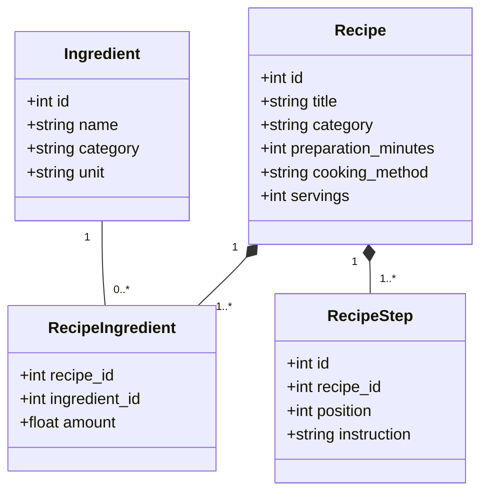
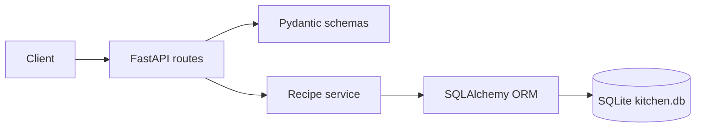

# Kitchen Ledger — каталог рецептов

Учебное веб-приложение для хранения ингредиентов и рецептов. Реализовано на Python, FastAPI, SQLAlchemy ORM и SQLite. Веб-интерфейс и REST API запускаются одним сервером.

## Проблема и цель

Рецепты и списки ингредиентов часто хранятся разрозненно. Из-за этого сложно найти блюдо по имеющимся продуктам, сравнить время приготовления и сохранить последовательность операций для сложных блюд. Kitchen Ledger собирает каталог в одном месте и поддерживает поиск по названию, категории, способу приготовления, времени и ингредиентам.

## Бизнес-требования

| ID | Требование | Критерий приёмки |
|---|---|---|
| BR-01 | Каталог хранит ингредиенты с единицами измерения и категориями | Ингредиент можно создать и получить через API |
| BR-02 | Рецепт содержит название, категорию, время, способ и порции | Рецепт сохраняется со списком ингредиентов и шагами |
| BR-03 | Сложный рецепт состоит из упорядоченных операций | Шаги возвращаются в заданном порядке |
| BR-04 | Пользователь ищет рецепты по названию и фильтрам | Поиск поддерживает текст, категорию, способ и верхний предел времени |
| BR-05 | Пользователь ищет рецепты, содержащие указанные ингредиенты | Можно передать один или несколько ингредиентов |
| BR-06 | Данные переживают перезапуск приложения | SQLAlchemy сохраняет данные в SQLite-файл `kitchen.db` |

### Область первой версии

Включены каталог ингредиентов, создание/чтение рецептов, фильтрация и браузерный интерфейс. Авторизация, изображения, редактирование/удаление, планирование меню и расчёт пищевой ценности не входят в первую версию.

## Архитектура

Слои: HTTP API (FastAPI) → схемы ввода/вывода (Pydantic) → сервисы предметной области → SQLAlchemy ORM и SQLite. API не содержит SQL-запросов напрямую; бизнес-операции сосредоточены в сервисе рецептов.





## Запуск

Требуется Python 3.11 или новее.

```bash
python -m venv .venv
# Windows PowerShell:
.venv\Scripts\Activate.ps1
# macOS/Linux: source .venv/bin/activate
pip install -r requirements.txt
uvicorn app.main:app --reload
```

В Windows можно запустить `.\run.ps1` из PowerShell: скрипт создаст виртуальное окружение, установит зависимости и запустит сервер. Тот же проект можно открыть в VS Code и выполнить команды запуска во встроенном терминале PowerShell; OpenCode не требуется.

Откройте <http://127.0.0.1:8000/> для веб-интерфейса или <http://127.0.0.1:8000/docs> для интерактивной документации API. База `kitchen.db` создаётся в текущей директории при первом запуске. В OpenCode достаточно открыть каталог `kitchen-ledger` и выполнить команды в терминале.

При первом запуске в каталоге уже будет демонстрационный рецепт «Овощной суп». Для показа откройте веб-интерфейс, найдите рецепт по категории или ингредиентам и создайте свой через кнопку «Новый рецепт». Для проверки API используйте `/docs`: создайте рецепт через `POST /recipes`, затем найдите его через `GET /recipes`.

## API

- `POST /ingredients` — добавить ингредиент.
- `GET /ingredients` — список ингредиентов.
- `POST /recipes` — создать рецепт с ингредиентами и шагами.
- `GET /recipes` — поиск: `q`, `category`, `method`, `max_minutes`, `ingredients` (список через запятую).
- `GET /recipes/{id}` — получить рецепт.
- `GET /health` — проверка доступности.

Пример создания рецепта:

```json
{
  "title": "Овощной суп",
  "category": "Супы",
  "preparation_minutes": 35,
  "cooking_method": "варка",
  "servings": 4,
  "ingredients": [{"name": "Картофель", "category": "Овощи", "unit": "г", "amount": 300}],
  "steps": ["Нарезать овощи", "Варить до готовности"]
}
```
